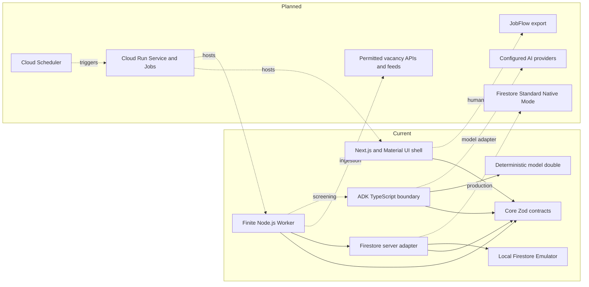

# Architecture

JobScout uses one pnpm workspace with two deployment artifacts. Next.js App Router serves the shell and HTTP health route. The Worker validates configuration, checks Firestore reachability with a deadline, terminates the client, and exits. There is currently no invocation path from either app to a real AI model.

Apps may use shared packages only through exported root entry points and may not import each other's modules. Agent and Firestore depend only on Core among workspace packages. Core contains domain rules and Zod schemas, with no infrastructure or UI SDKs. Source-mode Node and Vitest consume TypeScript entry points, and production builds consume compiled ESM. TypeScript resolves intra-module imports using the layer tsconfig, including the Web's `@/` alias and NodeNext package resolution. The architecture check inspects source import/export expressions, literal dynamic imports, type imports, and reference directives under the five `src` roots. Cycles include type links. Framework configuration, generated files, deployment artifacts, and dependency internals are outside this source graph. The package-manager and build checks independently exercise exports and manifests.

All runtime entry points validate the environment. Local and test use synthetic projects and Firestore Emulator, with loopback required for seed and reset. Production rejects emulator settings, mock auth/providers, and demo IDs. Use server-only data and configuration, validate external boundaries and treat vacancy descriptions and model results as untrusted. See [local development](local-development.md) and [decisions](decisions/README.md).

The planned Cloud Run deployment uses one initial production project, distinct least-privilege service identities, Secret Manager and WIF. Select the region and verify quotas, availability and billing before provisioning. Jobs should have bounded work, scale idle services to zero, and persist pending work. Planned provider routing uses Gemini Flash-Lite first, Groq-hosted GPT-OSS as fallback, and possibly Cloudflare Workers AI. Configure IDs outside code. Classify errors, bound retries, use circuit breakers, preserve pending work on exhaustion, and never switch to a paid provider automatically. Verify current quotas, terms, and European eligibility before enabling any provider.
